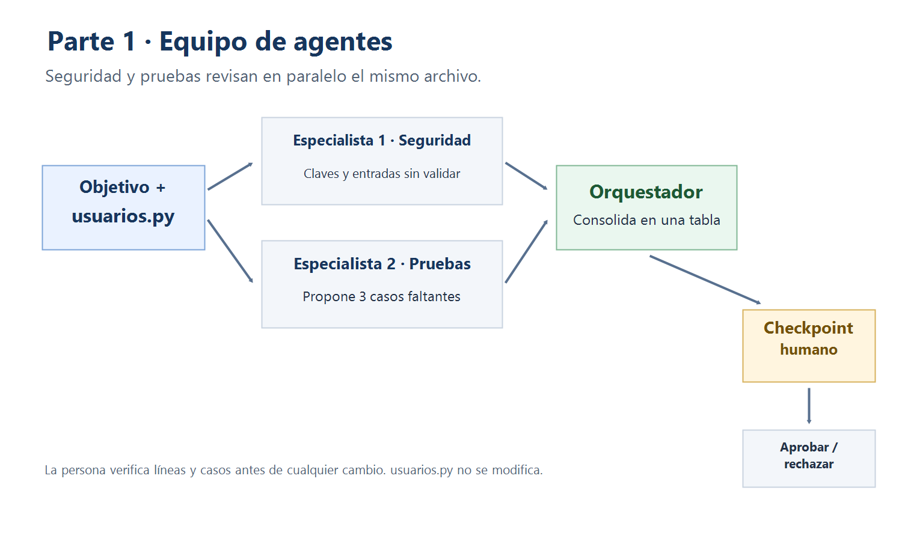
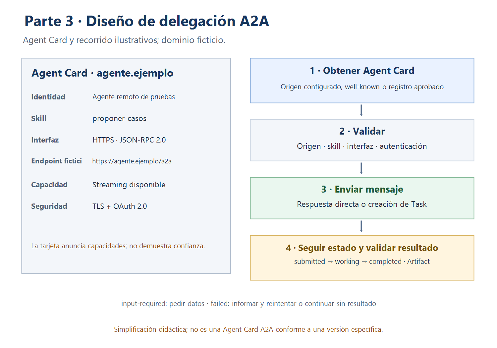
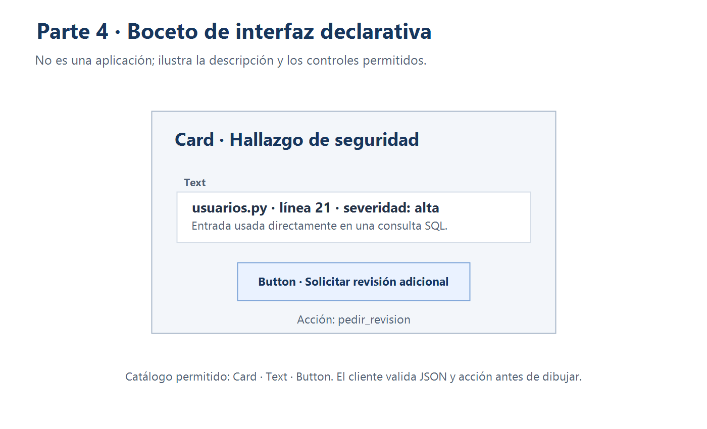

# Respuestas

## Parte 2 — Subagente local

- **Herramienta:** GitHub Copilot en VS Code. El entorno de trabajo reporta VS Code 1.145.3; no se pudo confirmar la versión de la extensión Copilot. Antes de entregar, anotar la versión que muestra la vista Extensions de tu VS Code.
- **Archivo y formato:** `.github/agents/revisor-seguridad.agent.md`, perfil de agente personalizado Markdown con frontmatter YAML.
- **Invocación prevista:** pedir al agente principal de Copilot que delegue explícitamente en `revisor-seguridad` la revisión de `usuarios.py`; comprobar en la actividad que aparece la llamada al subagente y su respuesta. Si solo se selecciona el perfil en el selector y este contesta directamente, eso prueba la ejecución del agente personalizado, pero no necesariamente la delegación como subagente que pide el deber.
- **Permisos mínimos:** `read` y `search`; no se habilitan herramientas de escritura, edición ni terminal para el perfil.

Un perfil de agente local es delegación dentro del harness de Copilot: el harness carga las instrucciones y herramientas del perfil. No implementa A2A: no descubre ni se comunica con un agente remoto usando ese protocolo.

### Hallazgos contrastados en `usuarios.py`

| Línea | Problema | Severidad |
|---:|---|---|
| 10 | Hay una constante con apariencia de clave API escrita directamente en el código. El propio archivo la identifica como un valor de ejemplo; no se reproduce su contenido aquí. | Baja (ejemplo) |
| 11, 42 | La contraseña de administrador está fija en el código y `es_admin` la compara directamente con el valor recibido. No se debe divulgar el valor literal. | Alta |
| 21 | `buscar_usuario` concatena `nombre` directamente en la consulta SQL, sin validación ni parámetros. | Alta |
| 30–34 | `crear_usuario` usa parámetros SQL (mitiga inyección en esa consulta), pero no valida los valores de entrada como edad o formato de correo. | Media |

### Parte 4 — A2UI

**Salida convencional**

| Archivo | Línea | Severidad | Hallazgo |
|---|---:|---|---|
| `usuarios.py` | 21 | Alta | `buscar_usuario` concatena el nombre recibido en la consulta SQL en vez de validarlo y parametrizarlo. |

**Catálogo permitido para este ejemplo:** `Card` agrupa contenido; `Text` muestra texto plano; `Button` emite una acción identificada. El cliente solo acepta esos componentes y valida cada campo.

> *Ilustración didáctica; no es un mensaje A2UI estándar válido.*

```json
{
  "component": "Card",
  "children": [
    {
      "component": "Text",
      "text": "usuarios.py · línea 21 · severidad: alta — entrada usada directamente en una consulta SQL"
    },
    {
      "component": "Button",
      "label": "Solicitar revisión adicional",
      "event": "pedir_revision",
      "data": {
        "file": "usuarios.py",
        "line": 21,
        "finding_id": "SQL-01"
      }
    }
  ]
}
```

Un agente o una plantilla produce la descripción estructurada; A2UI es el formato/protocolo de esa descripción, no un LLM. El LLM puede generar la descripción o una herramienta puede devolver una plantilla predefinida. El flujo es: agente/plantilla produce descripción → cliente valida esquema, catálogo, datos, acciones y enlaces → renderer dibuja componentes ya implementados → usuario actúa → aplicación recibe el evento. MCP no es obligatorio para renderizar. Generative UI es el enfoque general; una tabla Markdown o un artefacto interactivo no implica que se esté usando el formato A2UI.

Si un componente no está permitido, el cliente lo rechaza o lo omite de forma segura y registra el motivo. Si una acción no está permitida, una URL no está autorizada o el JSON es inválido, no renderiza ni ejecuta esa parte y presenta un error controlado. El evento `pedir_revision` devuelve el identificador del hallazgo y la referencia de archivo/línea, no el contenido de credenciales. El botón no realiza por sí solo una operación sensible: el backend debe validar identidad, autorización y datos antes de atender la solicitud.

### Preguntas finales

1. **¿Por qué dos especialistas y no uno solo?** Separar seguridad de pruebas permite enfocar cada revisión y comparar resultados independientes. Agrega claridad y cobertura, pero cuesta más coordinación y puede haber duplicación o respuestas contradictorias.
2. **¿Cómo verificaste que el subagente se ejecutó y que los hallazgos eran reales?** La captura muestra la invocación del perfil `revisor-seguridad` y su respuesta. Contrasté los hallazgos con `usuarios.py`. La primera respuesta informó una línea incorrecta; la consulta estaba en la línea 21. Al pedir una revisión de nuevo, se mostró la línea correcta. También comprobé con `git diff` que el archivo había sido modificado y, después de restaurarlo, que ya no tenía diferencias.
3. **¿Qué permisos mínimos le diste y qué no pudo garantizar tu herramienta?** El perfil declara solo `read` y `search`, sin herramientas de edición ni terminal. Sin embargo, durante la ejecución el agente indicó que corrigió la consulta y `git diff` confirmó la modificación; por ello, el perfil no impidió técnicamente esa escritura en esa ejecución. Restauré `usuarios.py` a `HEAD` y verifiqué que quedara intacto. La mitigación es ejecutar en un entorno realmente de solo lectura y verificar `git status` antes de aprobar; no se debe confiar solo en la instrucción del perfil.
4. **¿Cuándo bastan subagentes locales y cuándo conviene A2A?** Los locales bastan cuando el trabajo ocurre en el mismo entorno y harness. A2A compensa cuando un agente de otro equipo o servidor necesita interoperar mediante una interfaz de agente acordada.
5. **¿Cómo manejaría `input-required` o un fallo de la Task?** En `input-required`, pausa y solicita el dato faltante; ante `failed`, informa el error, no inventa un resultado y ofrece reintentar o seguir sin ese agente.
6. **¿Qué valida el cliente antes de dibujar la tarjeta y qué debe verificar el backend?** El cliente valida JSON, catálogo, tipos y valores, acción y URL autorizada. El backend verifica identidad, autorización y los datos recibidos antes de procesar `pedir_revision`.
7. **¿Cuándo conviene una plantilla fija en lugar de dejar que el LLM genere la descripción?** Cuando la interfaz debe ser consistente y predecible, el catálogo es reducido o se requiere validar de manera estricta acciones y contenido.

### Evidencias

#### Parte 1 — Flujo


#### Parte 3 — A2A



#### Parte 4 — A2UI


